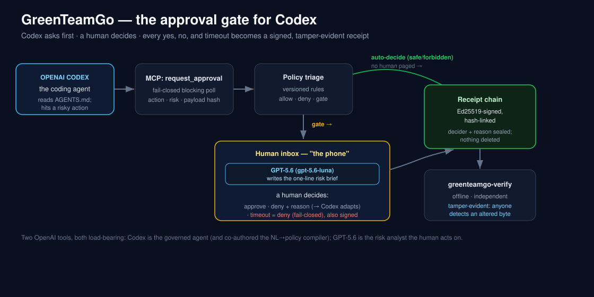

# GreenTeamGo

[](https://github.com/axiom-orion/greenteamgo/actions/workflows/ci.yml)

**An approval gate for AI coding agents, with receipts you can check yourself.**

Before an agent does something risky (a force-push, a destructive shell command, a payment) it asks first. Policy answers the routine requests; a human answers the rest. Every yes, no and timeout becomes an Ed25519-signed, hash-linked receipt. Anyone holding the public key can verify the whole chain offline, and a single changed character makes verification fail.

Unanswered requests fail closed: no decision by the deadline is a deny, and that expiry is sealed into the chain too.



## See it in 60 seconds

No agent, API key or account needed. Requires Node 22+.

```bash
npm install
npm run build
npm run demo
```

`npm run demo` starts the console on a free port, replays 20 agent actions through it, exports the signed chain, stops the console, then verifies the chain twice: once untouched, once with one character flipped.

```
[2/5] Replaying 20 agent actions: 14 reads (policy decides), 6 risky (a human decides)
  METRIC: 20 actions — policy auto-decided 14 (auto-allowed); a human was paged for
  only the 6 that mattered (approved 4, denied 2). 20 signed, hash-linked receipts.

[4/5] Verify the untouched chain (expect PASS)
  OK: 20 receipt(s) verified — chain intact, signatures valid.

[5/5] Flip ONE character of one receipt, then verify again (expect FAIL)
  receipt #0, field "reason": "auto-decided by policy pol_demo v1"
                           -> "euto-decided by policy pol_demo v1"
  greenteamgo-verify: index 0: receipt_hash mismatch — content was tampered
```

The command exits 0 only if the real chain passes and the edited chain fails. CI runs it on every pull request, so the claim above is a tested property, not a description.

## What the demo shows

- **Policy keeps humans out of the routine.** 14 of 20 actions are reads, and the policy allows them without paging anyone. Each still gets a receipt naming the policy and version that decided.
- **A human decides what matters.** The 6 risky actions wait for a person. Their receipts record a human decider and the reason given.
- **The record is tamper-evident.** Each receipt carries the hash of the one before it and a signature over its canonical form. Editing, deleting or reordering any receipt breaks verification.
- **Verification needs nothing from the server.** The verifier is a small CLI that reads two JSON files: the chain and the public key.

## Use it with a real agent

GreenTeamGo is an MCP server, so any MCP-capable agent can call its `request_approval` tool. It was built and demoed against the OpenAI Codex CLI; [`packages/mcp/README.md`](packages/mcp/README.md) has the Claude Code setup.

[`demo/README.md`](demo/README.md) walks through the live version: start the console, point the agent at it, ask for something risky, and approve or deny it in the browser.

## How it works

1. The agent calls `request_approval` with the action it wants to take.
2. The policy package evaluates it: allow, deny, gate (ask a human) or challenge.
3. Gated requests wait in the inbox. A human approves or denies, or the deadline passes and the request is denied.
4. The decision is sealed as a receipt: canonical serialization, SHA-256 link to the previous receipt, Ed25519 signature.
5. The chain and public key can be exported at any time and verified offline.

## Packages

| Package | What it does |
|---|---|
| [`packages/core`](packages/core) | Receipts: canonical serialization (golden-vector tested), Ed25519 signing, hash linking, and the `greenteamgo-verify` CLI. |
| [`packages/api`](packages/api) | The inbox API: create → poll → decide, fail-closed expiry sealed into the chain, scoped API keys, idempotency, policy-driven auto-decisions, chain and key export. |
| [`packages/policy`](packages/policy) | Versioned policy rules: allow / deny / gate / challenge, evaluated before a human is paged. |
| [`packages/identity`](packages/identity) | Agent API keys: minting, hashed storage (SHA-256, never plaintext), scope resolution. |
| [`packages/mcp`](packages/mcp) | The stdio MCP server agents install. Fail-closed polling and a hash-only mode. |
| [`packages/notify`](packages/notify) | Inbox-item schema and pluggable delivery (webhook today). A delivery failure never changes a request's outcome. |
| [`packages/redteamgo`](packages/redteamgo) | RedTeamGo: edge middleware that classifies inbound agents, applies per-path policy, and seals each enforcement decision into the same chain. |
| [`apps/console`](apps/console) | Local demo console: the inbox API and a web approval page in one process. |

Green and Red share one receipt format. Read [`docs/receipt-envelope.md`](docs/receipt-envelope.md) before changing receipt shapes.

## Status and limits

- **Tested:** 141 tests across the seven packages, plus the end-to-end demo, all run in CI.
- **Storage is in memory.** The console generates a fresh signing key on each start and keeps the chain in RAM. It is a demo, not a deployment. A Postgres store and hosted API are not built yet.
- **No mobile app.** The "phone" in the demo is a web page. Push delivery is a webhook interface with no FCM adapter yet.
- **The optional risk summary calls OpenAI.** With no key it falls back to the agent's own summary, which is how `npm run demo` runs.

## Development

```bash
npm install
npm run build   # every workspace, in dependency order
npm test        # every package's tests
npm run demo    # end-to-end: approve, sign, verify, tamper
```

Built on Vorion (BASIS / RFC-0002).

## License

[MIT](LICENSE).
